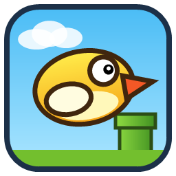
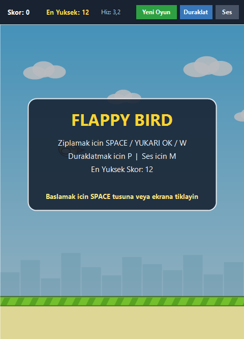
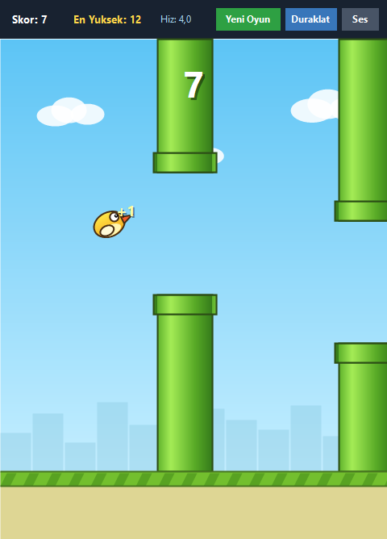
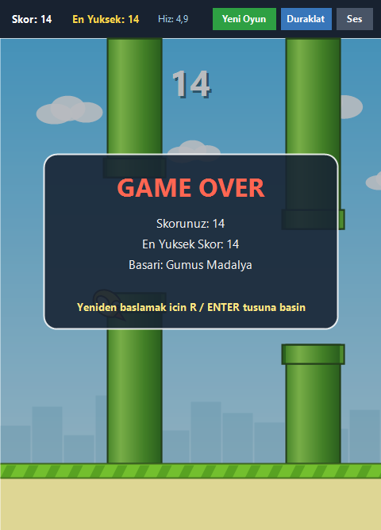

<p align="center">
  
</p>

# YMH219 - Flappy Bird (C# / .NET Windows Forms)

Windows Forms üzerinde zamanlayıcı (`Timer`), klavye olayları (`KeyDown`, `KeyUp`, `PreviewKeyDown`) ve nesne tabanlı programlama (OOP) ilkeleri kullanılarak geliştirilmiş masaüstü **Flappy Bird** oyunu.

## Projenin Amacı

Bu proje, YMH219 dersi kapsamında aşağıdaki kavramların uygulamalı olarak pekiştirilmesi amacıyla geliştirilmiştir:

- **Form Kontrolleri ve Olay Yönetimi:** `Panel`, `Label`, `Button` kontrolleri ile `KeyDown`, `KeyUp`, `PreviewKeyDown`, `MouseDown` ve `Paint` olaylarının yönetimi.
- **Zamanlayıcı (Timer) ile Oyun Döngüsü:** `System.Windows.Forms.Timer` kullanarak yaklaşık 60 FPS (16 ms) akışta hareket, animasyon ve yeniden çizim yönetimi.
- **Nesne Tabanlı Mimari (OOP):** Oyuncu (`Bird`), engel (`PipeObstacle`), zemin (`Ground`), bulut (`Cloud`), skor efekti (`FloatingText`), ses (`SoundManager`), skor kaydı (`HighScoreManager`) ve merkezi oyun motoru (`GameEngine`) sınıflarının ayrıştırılması.
- **Fizik, Çarpışma ve Oyun Durumu:** Yerçekimi, zıplama ivmesi, ekran dışına çıkan boruların yeniden konumlandırılması, `RectangleF.IntersectsWith` ile çarpışma tespiti ve `GameStatus` (`Ready`, `Playing`, `Paused`, `GameOver`) durum yönetimi.

## Kullanılan Teknolojiler

- **Dil:** C# (.NET 10)
- **Arayüz:** Windows Forms (WinForms) & GDI+ (`System.Drawing`)
- **Çift Tamponlu Çizim:** Titremesiz görüntüleme için özel `GameCanvasPanel` (`DoubleBuffered`)
- **Ses Efektleri:** Harici dosya gerektirmeden bellekte WAV üreten `SoundManager`
- **Sürüm Kontrolü:** Git & GitHub

## Özellikler

- Klavye (`Space`, `Yukarı Ok`, `W`) veya fare sol tıklama ile kuşu yukarı zıplatma, yerçekimi etkisiyle doğal düşüş ve eğim açısı animasyonu.
- Sağdan sola sürekli hareket eden 3 adet 3D gölgeli boru engeli ve ekran dışına çıkan engellerin rastgele boşluk yüksekliğiyle yeniden konumlandırılması.
- Boru, zemin veya tavan çarpışmasında oyunun durması ve madalya/skor özetli **Game Over** ekranı.
- Engeller geçildikçe anlık skor artışı (`+1` efekti), dinamik hız/zorluk artışı ve yerel en yüksek skor kaydı.
- Üst bilgi çubuğunda canlı **Skor**, **En Yüksek Skor**, **Hız** göstergeleri ile **Yeni Oyun**, **Duraklat** ve **Ses** butonları.

## Kontroller

| Tuş / İşlem | Görev |
| --- | --- |
| `Space` / `Yukarı Ok` / `W` / `Sol Tık` | Zıpla / Oyunu başlat |
| `P` veya **Duraklat** butonu | Oyunu duraklat / devam ettir |
| `R` / `Enter` veya **Yeni Oyun** butonu | Yeni oyun / Yeniden başlat |
| `M` veya **Ses** butonu | Ses efektlerini aç / kapat |

## Kurulum ve Çalıştırma Adımları

### Gereksinimler
- Windows 10 veya Windows 11
- [.NET 10 SDK](https://dotnet.microsoft.com/download) (veya Visual Studio 2022/2026 Desktop Development with .NET iş yükü)

### Terminal Üzerinden Çalıştırma
```bash
git clone https://github.com/keremkck23/YMH219-FlappyBird.git
cd YMH219-FlappyBird
dotnet build FlappyBird.sln
dotnet run --project src/FlappyBird/FlappyBird.csproj
```

### Visual Studio ile Çalıştırma
1. `FlappyBird.sln` dosyasını Visual Studio ile açın.
2. Başlangıç projesi olarak `FlappyBird` seçili olduğundan emin olun.
3. `F5` tuşuna basarak uygulamayı derleyip çalıştırın.

## Proje Yapısı

```text
YMH219-FlappyBird/
├── FlappyBird.sln
├── .gitignore
├── README.md
├── docs/
│   └── screenshots/
│       ├── start-screen.png
│       ├── gameplay.png
│       └── game-over.png
└── src/
    └── FlappyBird/
        ├── FlappyBird.csproj
        ├── Program.cs
        ├── MainForm.cs
        ├── MainForm.Designer.cs
        ├── Controls/
        │   └── GameCanvasPanel.cs
        ├── Core/
        │   ├── GameConfig.cs
        │   ├── GameEngine.cs
        │   └── GameStatus.cs
        ├── Models/
        │   ├── Bird.cs
        │   ├── Cloud.cs
        │   ├── FloatingText.cs
        │   ├── Ground.cs
        │   └── PipeObstacle.cs
        ├── Rendering/
        │   └── GameRenderer.cs
        └── Services/
            ├── HighScoreManager.cs
            └── SoundManager.cs
```

## Ekran Görüntüleri

### Başlangıç Ekranı


### Oyun İçi Görünüm


### Game Over Ekranı

